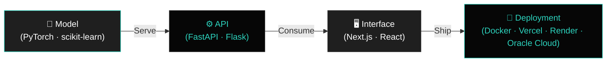

<picture>
  <source media="(prefers-color-scheme: dark)" srcset="https://raw.githubusercontent.com/shanky-ux/shanky-ux/main/profiles/default/dark.svg" />
  <source media="(prefers-color-scheme: light)" srcset="https://raw.githubusercontent.com/shanky-ux/shanky-ux/main/profiles/default/light.svg" />
  
</picture>

  <h1>Ravi Shankar</h1>

  

    <b>Where machine learning meets shipped product.</b> 
    Building intelligent systems from model → API → interface → deployment.
  

  

    
  

  

    
    
    
    
  

  

    
    
    
    
    
    
  

  

    <a href="https://ravish4nkar.vercel.app">Portfolio</a> •
    <a href="#how-i-build">How I Build</a> •
    <a href="#tech-stack">Tech Stack</a> •
    <a href="#recognition">Recognition</a> •
    <a href="#selected-projects">Projects</a> •
    <a href="#experience">Experience</a> •
    <a href="#open-source">Open Source</a> •
    <a href="#connect">Connect</a>
  

---

> **B.Tech CSE (AI & ML)** · SRM Institute of Science and Technology · Chennai, India

---

## How I Build

Every project follows the same pipeline: train the model, wrap it in an API, ship an interface, deploy it live.

---

## Tech Stack

<table align="center">
  <tr>
    <td align="center" width="96"> Python</td>
    <td align="center" width="96"> C</td>
    <td align="center" width="96"> JavaScript</td>
    <td align="center" width="96"> TypeScript</td>
    <td align="center" width="96"> React</td>
    <td align="center" width="96"> Next.js</td>
    <td align="center" width="96"> Vite</td>
  </tr>
  <tr>
    <td align="center" width="96"> PyTorch</td>
    <td align="center" width="96"> TensorFlow</td>
    <td align="center" width="96"> OpenCV</td>
    <td align="center" width="96"> Scikit-learn</td>
    <td align="center" width="96"> NumPy</td>
    <td align="center" width="96"> Pandas</td>
    <td align="center" width="96"> Jupyter</td>
  </tr>
  <tr>
    <td align="center" width="96"> FastAPI</td>
    <td align="center" width="96"> Flask</td>
    <td align="center" width="96"> Node.js</td>
    <td align="center" width="96"> HTML5</td>
    <td align="center" width="96"> Tailwind</td>
    <td align="center" width="96"> Capacitor</td>
    <td align="center" width="96"> Express</td>
  </tr>
  <tr>
    <td align="center" width="96"> PostgreSQL</td>
    <td align="center" width="96"> MySQL</td>
    <td align="center" width="96"> SQLite</td>
    <td align="center" width="96"> Docker</td>
    <td align="center" width="96"> Linux</td>
    <td align="center" width="96"> Git</td>
    <td align="center" width="96"> GitHub</td>
  </tr>
  <tr>
    <td align="center" width="96"> GCP</td>
    <td align="center" width="96"> Oracle</td>
    <td align="center" width="96"> Arduino</td>
    <td align="center" width="96"> Raspberry Pi</td>
    <td align="center" width="96"> Android Studio</td>
    <td align="center" width="96"> VS Code</td>
    <td align="center" width="96"> npm</td>
  </tr>
</table>

---

## Recognition

| Award | Event | Details |
| :---- | :---- | :------ |
| 🏆 **1st Place** | CareHack'26 | AI / ML Hackathon · ₹30,000 prize + internship offer |
| 🏆 **Winner** | YUVA National Hackathon | Hardware / IoT track |
| 🥇 **Top 1%** | Amazon ML Challenge | Rank 62 / 6,223 |
| 🏅 **4th Place** | DigiGreen Hackathon | — |
| 📄 **Co-author** | IEEE Publication | IoT-based Backpack Load Alert System |

---

## Selected Projects

<table align="center">
  <tr>
    <td width="50%">

### 🚀 Applivo

AI-powered SaaS platform for opportunity discovery and application automation.

**Stack:** FastAPI · Next.js · Docker Compose · Oracle Cloud

</td>
<td width="50%">

### 🧬 SkinScan AI

ML-powered skin disease classification platform.

**Stack:** PyTorch · FastAPI · Next.js

</td>
  </tr>
  <tr>
    <td width="50%">

### 🛰️ OrbitXOS

Interactive space debris tracking and collision-awareness platform.

**Stack:** React · Vite · Tailwind · Cesium · Skyfield

</td>
<td width="50%">

### 🔐 DigiVerify AI

AI-powered digital verification and fraud detection platform.

**Stack:** Python · Flask · MySQL

</td>
  </tr>
  <tr>
    <td width="50%">

### 📊 Student Performance Predictor

Machine learning system for predicting student academic performance.

**Stack:** Python · Scikit-learn

</td>
<td width="50%">

### 📈 Customer Churn Prediction

Batch prediction pipeline for customer churn forecasting.

**Stack:** JavaScript · Vertex AI · BigQuery

</td>
  </tr>
</table>

---

## Experience

| Role | Organization | Focus |
| :--- | :----------- | :---- |
| ML Intern | Vdart | Artificial Intelligence / Machine Learning |
| ML Intern | Prodigy InfoTech | Machine Learning · Model Optimization |
| Systems Development Intern | C-DAC Chennai | Linux · Systems Development |

---

## Open Source

Contributing to open-source projects including **Token Print** and **Telex**.

---

## GitHub Statistics

  

  
  

  
  

### Activity

  

### Contributions

  

---

## Connect

  
  
  
  

 

  

  <i>Building intelligent systems, shipping real products, and learning in public.</i>

