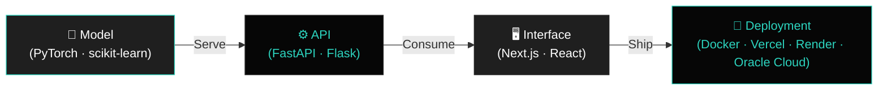

<picture>
  <source media="(prefers-color-scheme: dark)" srcset="https://raw.githubusercontent.com/shanky-ux/shanky-ux/main/profiles/default/dark.svg" />
  <source media="(prefers-color-scheme: light)" srcset="https://raw.githubusercontent.com/shanky-ux/shanky-ux/main/profiles/default/light.svg" />
  
</picture>

<div align="center">
  <a href="https://ravish4nkar.vercel.app">
    
  </a>

  <h1>Ravi Shankar</h1>

  <p>
    <b>Where machine learning meets shipped product.</b><br />
    AI / ML & Full-Stack Engineer building products from model → API → interface → deployment.
  </p>

  <p>
    <a href="https://github.com/shanky-ux?tab=followers"></a>
    <a href="https://github.com/shanky-ux?tab=repositories"></a>
    <a href="https://github.com/search?q=author%3Ashanky-ux+type%3Apr+is%3Amerged&type=pullrequests"></a>
    <a href="https://leetcode.com/ravishankar07/"></a>
    <a href="https://ravish4nkar.vercel.app"></a>
  </p>

  <p>
    <a href="https://www.python.org/"></a>
    <a href="https://pytorch.org/"></a>
    <a href="https://fastapi.tiangolo.com/"></a>
    <a href="https://nextjs.org/"></a>
    <a href="https://react.dev/"></a>
    <a href="https://www.typescriptlang.org/"></a>
    <a href="https://tailwindcss.com/"></a>
    <a href="https://www.docker.com/"></a>
    <a href="https://cloud.google.com/"></a>
  </p>

  <p>
    <a href="https://ravish4nkar.vercel.app">Launch Portfolio</a> •
    <a href="#how-i-build">How I Build</a> •
    <a href="#recognition">Recognition</a> •
    <a href="#selected-projects">Projects</a> •
    <a href="#experience">Experience</a> •
    <a href="#tech-stack">Tech Stack</a> •
    <a href="#open-source">Open Source</a> •
    <a href="#get-in-touch">Get in Touch</a>
  </p>
</div>

---

<div align="center">
  
</div>

> **B.Tech CSE (AI & ML)** · SRM Institute of Science and Technology · Chennai, India  
> **No setup needed to start:** explore everything live at **[ravish4nkar.vercel.app](https://ravish4nkar.vercel.app)**.

---

### 🧠 Machine Learning

Train, evaluate, and optimize models in PyTorch, TensorFlow, and scikit-learn, from skin disease classification to student performance prediction and fraud detection.

### ⚙️ Backend & APIs

Serve models and business logic through FastAPI, Flask, and Node.js, backed by PostgreSQL, MySQL, and SQLite.

### 🖥️ Full-Stack Interfaces

Ship responsive products with React, Next.js, TypeScript, Vite, and Tailwind, including 3D and mapping interfaces with Cesium.

### ⚡ Deployment & Systems

Containerize with Docker Compose and deploy to Oracle Cloud, GCP, Vercel, and Render, with Linux systems experience from C-DAC.

---

## How I Build

Every project follows the same pipeline: train the model, wrap it in an API, ship an interface, deploy it live.



### 1. Model

Prototype in Jupyter with NumPy, Pandas, and OpenCV. Train with PyTorch, TensorFlow, or scikit-learn, and evaluate before anything ships.

### 2. API

Wrap the model in a FastAPI or Flask service with a clean contract, so any interface can consume it.

### 3. Interface

Build the product UI in Next.js or React with TypeScript and Tailwind, connected to the API.

### 4. Deploy

Package with Docker Compose, then deploy to Oracle Cloud, Vercel, or Render.

---

## Recognition

| Award | Event | Details |
| :---- | :---- | :------ |
| 🏆 **1st Place** | CareHack'26 | AI / ML Hackathon · ₹30,000 prize + internship offer |
| 🏆 **Winner** | YUVA National Hackathon | Hardware / IoT track |
| 🥇 **Top 1%** | Amazon ML Challenge | Rank 62 / 6,223 |
| 🏅 **4th Place** | DigiGreen Hackathon | — |
| 📄 **Co-author** | IEEE Publication | IoT-based Backpack Load Alert System |

---

## Selected Projects

<table align="center">
  <tr>
    <td width="50%">

### 🚀 Applivo

AI-powered SaaS platform for opportunity discovery and application automation.

**Stack:** FastAPI · Next.js · Docker Compose · Oracle Cloud

<a href="https://applivo.in"></a>

</td>
<td width="50%">

### 🧬 SkinScan AI

ML-powered skin disease classification platform.

**Stack:** PyTorch · FastAPI · Next.js

<a href="https://skinscanai.vercel.app/"></a>

</td>
  </tr>
  <tr>
    <td width="50%">

### 🛰️ OrbitXOS

Interactive space debris tracking and collision-awareness platform.

**Stack:** React · Vite · Tailwind · Cesium · Skyfield

<a href="https://orbitxos-5b09.onrender.com"></a>

</td>
<td width="50%">

### 🔐 DigiVerify AI

AI-powered digital verification and fraud detection platform.

**Stack:** Python · Flask · MySQL

<a href="https://digiverify-ai-6.onrender.com"></a>

</td>
  </tr>
  <tr>
    <td width="50%">

### 📊 Student Performance Predictor

Machine learning system for predicting student academic performance.

**Stack:** Python · Scikit-learn

<a href="https://predicting-student-performance-with.onrender.com"></a>

</td>
<td width="50%">

### 📈 Customer Churn Prediction

Batch prediction pipeline for customer churn forecasting.

**Stack:** JavaScript · Vertex AI · BigQuery

<a href="https://github.com/shanky-ux/Customer_Churn_BatchPrediction"></a>

</td>
  </tr>
</table>

---

## Experience

| Role | Organization | Focus |
| :--- | :----------- | :---- |
| ML Intern | Vdart | Artificial Intelligence / Machine Learning |
| ML Intern | Prodigy InfoTech | Machine Learning · Model Optimization |
| Systems Development Intern | C-DAC Chennai | Linux · Systems Development |

---

## Tech Stack

| Category | Technologies |
| :------- | :----------- |
| **Languages** | `Python` `C` `JavaScript` `TypeScript` `HTML5` |
| **ML / AI** | `PyTorch` `TensorFlow` `OpenCV` `Scikit-learn` `NumPy` `Pandas` `Jupyter` |
| **Frontend** | `React` `Next.js` `Vite` `Tailwind` `Capacitor` |
| **Backend** | `FastAPI` `Flask` `Node.js` `Express` |
| **Databases** | `PostgreSQL` `MySQL` `SQLite` |
| **DevOps & Cloud** | `Docker` `Linux` `Git` `GitHub` `GCP` `Oracle Cloud` |
| **Hardware** | `Arduino` `Raspberry Pi` |
| **Tools** | `VS Code` `Android Studio` `npm` |

---

## Open Source

Contributions make the open-source community thrive. I contribute to projects including **Token Print** and **Telex**, following this workflow:

```bash
# 1. Fork the repository on GitHub, then clone your fork
git clone https://github.com/shanky-ux/<repository>.git
cd <repository>

# 2. Create a descriptive feature/fix branch
git checkout -b feat/my-contribution

# 3. Make your changes, verify, and commit
git commit -m "feat: describe your change"

# 4. Push to your branch and open a Pull Request
git push origin feat/my-contribution
```

<div align="center">
  <a href="https://github.com/search?q=author%3Ashanky-ux+type%3Apr+is%3Amerged&type=pullrequests"></a>
</div>

---

## 📈 GitHub Statistics

<div align="center">
  
</div>

<div align="center">
  
  
</div>

<div align="center">
  
  
</div>

<div align="center">
  
</div>

<div align="center">
  
</div>

---

## Get in Touch

<div align="center">
  <a href="https://ravish4nkar.vercel.app"></a>
  <a href="https://www.linkedin.com/in/ravi-shankar-b-77b5b9377/"></a>
  <a href="mailto:ravishankarx2005@gmail.com"></a>
  <a href="https://leetcode.com/ravishankar07/"></a>
</div>

<br />

<div align="center">
  
</div>

<div align="center">
  <sub>Building intelligent systems, shipping real products, and learning in public.</sub>
</div>
